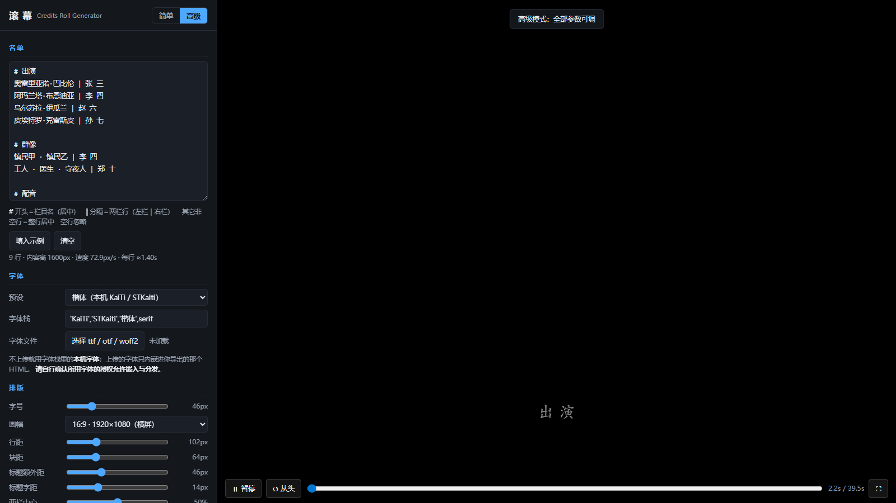
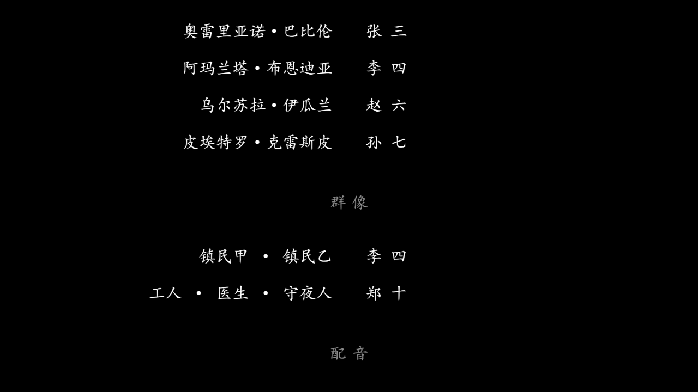

# 滚幕 · Credits Roll Generator

> 电影片尾字幕 / 滚动谢幕表生成器 —— 单文件、零依赖、打开即用。

把一份名单变成一段**匀速上滚的谢幕字幕**，并导出一个「双击即播」的单文件 HTML。
不装任何东西、不需要构建、不联网。

**打开 `index.html` 就能用。**





---

## 它能做什么

- 输入一份名单（栏目 + 两栏行），实时预览电影片尾式的滚动效果
- 一键导出**单文件 HTML**：字体、名单、播放逻辑全部内嵌，零外部请求，
  可以直接发给别人、挂到静态托管（GitHub Pages / Vercel / 对象存储），或嵌进课件与网页
- 支持视差背景层（大字背景以不同速度滚动，形成前后景深）
- 支持横屏 / 竖屏 / 方形 / 4:3 四种画幅
- 配置可存档为 `.json`，也可以导入别人的配置接着改

## 快速开始

1. 双击打开 `index.html`（推荐 Chrome / Edge）
2. 在「名单」框里写名单，右侧实时预览
3. 点 **导出成品 HTML**，得到 `谢幕表.html` —— 发给谁都能直接打开播放

默认就是「简单模式」，只有字号、时长、颜色几个参数；点右上角 **高级** 切出全部参数。

## 名单语法

纯文本，三种行：

```text
# 出演                      ← # 开头：栏目名（居中标题）
奥雷里亚诺·巴比伦 | 张 三     ← A | B：两栏行（左栏右对齐，右栏左对齐）
镇民甲 · 镇民乙 | 李 四
加西亚·马尔克斯              ← 不带 | ：整行居中
> 谢 幕                     ← > 开头：强制整行居中（一般用于收尾大字）
```

空行忽略；行首尾空格自动去掉。栏目之间自动加块距。

## 参数一览

### 简单模式

| 参数 | 说明 |
|---|---|
| 名单 | 见上方语法 |
| 字体文件 | 选一个本地 ttf / otf / woff2，会内嵌进导出的 HTML；不选则用高级模式里的「字体栈」 |
| 字号 | 全片统一字号（px） |
| 滚动时长 | 内容从画面底滚到完全出画所用的秒数（速度由它自动反推） |
| 背景 / 文字 | 两种颜色，默认纯黑底纯白字 |
| 循环播放 | 滚完是否自动从头再来 |

### 高级模式（额外）

| 参数 | 说明 |
|---|---|
| 画幅 | 16:9（1920×1080）／ 9:16（1080×1920，竖屏）／ 1:1 ／ 4:3 |
| 行距 | 每行基线间距（px） |
| 块距 | 栏目与栏目之间的额外间距 |
| 标题额外距 / 字距 | 栏目名与首行的间距；栏目名的字间距 |
| 两栏中心 / 两栏沟槽 | 左右两栏中间那条缝的位置（占画宽百分比）与宽度 |
| 起点留白 | 内容顶端初始在画面下方多远（决定开头黑场多久） |
| 结尾黑场 | 滚完之后留多少秒全黑 |
| 标题亮度 | 栏目名相对正文的不透明度（层级靠它区分） |
| 渲染精度 | 高清（跟随屏幕 DPR）／ 标准 1× ／ 2× 超采样（投影、录屏用） |
| 字体预设 | 楷体 / 宋体 / 黑体 / 衬线 / 无衬线，或自定义字体栈 |
| 页面标题 | 成品 HTML 的 `<title>` 与导出文件名 |
| 视差背景层 | 背景大字以「滚动倍率 × 主速度」移动并纵向平铺；倍率 < 100% 即产生前后景深 |

### 导出

| 产物 | 内容 |
|---|---|
| 成品 HTML | 单文件、打开即自动播放；内嵌字体（如上传）与全部配置；零外部请求；双击全屏、空格暂停 |
| 配置 JSON | 当前全部参数；可导入恢复，也可分享给别人改 |

配置同时会自动存在浏览器 localStorage，下次打开接着上次的改。

## 预览辅助

- **状态读数**：名单框下方实时显示「行数 · 内容总高 · 滚动速度 · 每行停留秒数」，
  方便你把时长调到读起来舒服的节奏（经验值：每行 0.8～1.5 秒）
- **越界预警**：某行文字宽到会滚出画框时直接提示，不用等导出才发现
- **进度条**：可拖动定位任意时刻（拖动时自动暂停），配合 ⛶ 全屏找构图很方便
- 快捷键：`空格` 播放/暂停；预览里双击 = 全屏

## 字体授权（重要）

- 本项目**不附带任何字体文件**，仓库本身 100% 原创代码，MIT 授权。
- 你上传的字体只会被**内嵌进你自己导出的 HTML**，不会上传到任何服务器。
- 使用前请自行确认该字体的授权允许「嵌入 / 分发」。
  想要楷书风格的免费商用字体，可以考虑：阿里妈妈东方大楷、霞鹜文楷、思源宋体等（各自授权不同，请自行阅读）。

## 技术说明

- 纯原生 HTML + CSS + Canvas，无任何第三方库、无构建步骤
- 渲染是 `t → 画面` 的纯函数：同一时刻永远画出同一帧，画面边缘硬切（电影字幕的标准做法）
- 预览与导出共用**同一份播放器代码**（`index.html` 内的 `#tpl-player` 模板），
  所以预览里看到什么，导出去就是什么
- 名单 / 排版全部参数集中在编辑器一个配置对象里，方便二次开发

## 目录

```
谢幕/
├── index.html          # 生成器（唯一需要打开的文件）
├── examples/demo.html  # 用默认配置导出的成品示例
├── docs/               # README 截图
├── README.md
└── LICENSE             # MIT
```

## 适用场景

课本剧 / 毕业晚会 / 社团活动谢幕表 · 婚礼与年会致谢 · 游戏与短片制作名单 ·
课件结尾致谢 · 直播间循环滚动感谢名单（竖屏画幅 + 循环）

## License

[MIT](LICENSE) © 2026 龚子昂 (Arkadegong)
